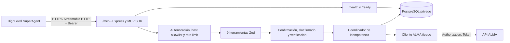

# Arquitectura

## Vista general



No existe n8n entre HighLevel y ALMA.

## Componentes

### Capa HTTP/MCP

- `createMcpExpressApp` aplica parsing JSON y allowlist de `Host`.
- `/mcp` exige Bearer, rate limit y sesiones Streamable HTTP.
- Se crea un `McpServer` por sesión para aislar negociación/capacidades.
- `POST`, `GET` y `DELETE` se delegan al transporte oficial.
- Las respuestas usan JSON estructurado; no se depende de SSE para las llamadas normales.
- Las sesiones expiran y hay un máximo configurable para limitar memoria.

Las sesiones están en memoria. El despliegue inicial debe usar una réplica. Para múltiples réplicas se necesita afinidad de sesión o un diseño de sesiones/eventos compartidos antes de escalar horizontalmente.

### Herramientas

Cada herramienta tiene:

- nombre estable en español;
- esquema Zod estricto (`unknownKeys` rechazadas);
- descripción operativa para el agente;
- anotaciones read-only/destructiva/idempotente;
- salida común con `ok`, `operation`, `message`, `data`, `error` y `meta`.

### Cliente ALMA

- Rutas constantes y URL base normalizada.
- Timeout por `AbortController`.
- Retries limitados solo en `GET` por red/timeout/status transitorio.
- `POST`, `PUT` y `DELETE` se ejecutan una sola vez.
- Envelope y `data` se validan por endpoint.
- Los errores salientes son códigos/mensajes seguros; no incluyen request body, token o URL con PII.

### Slots firmados

`consultar_disponibilidad` convierte cada resultado ALMA en un slot con token HMAC-SHA256. El payload contiene IDs, fecha, horas, zona horaria, emisión, expiración y nonce. Crear/reagendar toman sus datos de agenda del token, no del texto producido por el modelo.

El token:

- no puede ser inventado o modificado;
- caduca según `SLOT_TOKEN_TTL_SECONDS`;
- se invalida si cambia la zona horaria configurada;
- se registra por hash al consumirse y no puede reutilizarse con otra operación.

### PostgreSQL

`mutation_operations` registra clave de idempotencia, hash de la solicitud, estado y respuesta/error sanitizado. `consumed_slot_tokens` evita reutilización. `audit_events` almacena únicamente operación, resultado, entidad, correlación, fingerprint y timestamp.

No se guardan conversaciones, prompts, tokens, nombres, documento, teléfono, correo ni observaciones en auditoría.

## Flujo de creación

```mermaid
sequenceDiagram
    participant H as HighLevel
    participant M as ALMA MCP
    participant D as PostgreSQL
    participant A as ALMA
    H->>M: consultar_disponibilidad
    M->>A: GET disponibilidad
    A-->>M: slots reales
    M-->>H: slots + slot_token
    H->>M: crear_cita(confirmacion=true, idempotency_key, slot_token)
    M->>M: verificar firma y expiración
    M->>D: lock contacto + slot; registrar pending
    M->>A: POST cita (una sola vez)
    A-->>M: cita o error
    M->>D: succeeded / failed / uncertain + auditoría
    M-->>H: salida estructurada
```

## Estados de idempotencia

| Estado | Significado | Repetición de la misma clave |
|---|---|---|
| `pending` | Registrada; puede estar en curso o el proceso pudo interrumpirse | Bloqueada, requiere revisión |
| `succeeded` | ALMA confirmó y la respuesta fue persistida | Devuelve la respuesta almacenada |
| `failed` | ALMA rechazó de forma definida | Devuelve el mismo error |
| `uncertain` | Timeout/red tras iniciar mutación | Bloqueada hasta reconciliación |

Una clave usada con payload diferente genera `IDEMPOTENCIA_CONFLICTO`.

## Concurrencia

- Crear: lock por contacto/documento hasheado y por slot.
- Reagendar: lock por cita y por nuevo slot.
- Cancelar: lock por cita.
- Los locks se adquieren en orden para evitar deadlocks.
- ALMA sigue siendo la autoridad final de disponibilidad.

## Disponibilidad y fallos

- `/health` solo prueba que el proceso responde.
- `/ready` ejecuta `SELECT 1`; deliberadamente no llama a ALMA.
- Si PostgreSQL cae, la instancia no está lista para tráfico.
- Si ALMA cae, las lecturas devuelven error retryable después de retries; las mutaciones quedan sin retry automático.
- El apagado deja de aceptar conexiones, cierra sesiones y termina el pool con un límite temporal.
